# ER diagram

Generated from the running database (5 schemas, 34 tables, the `audit_entries` tables left out). One schema per module. Solid lines are real foreign keys inside a module. Dotted lines are links **across modules**: they hold a code or id but have no foreign key, by design (see [database-schema.md](database-schema.md) rule 2).

The diagram below shows the main columns only. [er-diagram-full.mmd](er-diagram-full.mmd) has every column of every table.

```mermaid
erDiagram
  %% ---------- network ----------
  stations {
    uuid id PK
    text code "unique, e.g. CEN"
    text name
    bool is_active
  }
  platforms {
    uuid id PK
    uuid station_id FK
    text code
  }
  routes {
    uuid id PK
    text code
    text name
  }
  route_stops {
    uuid route_id FK
    int sequence
    uuid station_id FK
    int minutes_from_previous
  }
  timetable_versions {
    uuid id PK
    text label
    text status "Draft, InReview, Published"
    text author
    text approved_by
  }
  service_calendars {
    uuid id PK
    text code
    bool monday "and the other days"
  }
  calendar_exceptions {
    uuid calendar_id FK
    date date
    text kind
  }
  services {
    uuid id PK
    uuid timetable_version_id FK
    uuid route_id FK
    uuid calendar_id FK
    text train_number
  }
  service_stops {
    uuid service_id FK
    int sequence
    uuid station_id FK
    int arrival_minutes
    int departure_minutes
  }
  station_translations {
    uuid station_id FK
    text language_code FK
    text name
  }
  languages {
    text code PK
    text name
  }

  stations ||--o{ platforms : has
  stations ||--o{ route_stops : "called at"
  routes ||--o{ route_stops : has
  routes ||--o{ services : "runs as"
  timetable_versions ||--o{ services : contains
  service_calendars ||--o{ services : "runs on"
  service_calendars ||--o{ calendar_exceptions : has
  services ||--o{ service_stops : has
  stations ||--o{ service_stops : "called at"
  stations ||--o{ station_translations : named
  languages ||--o{ station_translations : in

  %% ---------- journeys ----------
  journeys {
    uuid id PK
    uuid service_id "from network"
    date service_date
    text train_number
    text origin_station_code
    text destination_station_code
    text lifecycle
    int delay_minutes
    text delay_reason_code
    int version
  }
  journey_stops {
    uuid journey_id FK
    int sequence
    text station_code "from network"
    text state
    timestamptz scheduled_departure_utc
    timestamptz estimated_departure_utc
    timestamptz actual_departure_utc
    text platform_code
  }
  journey_events {
    uuid id PK
    uuid journey_id FK
    text event_type
    text source_kind
    timestamptz occurred_at_source
    text disposition
  }
  vehicles {
    uuid id PK
    text code
    text name
    bool is_active
  }
  vehicle_assignments {
    uuid journey_id FK
    uuid vehicle_id FK
    timestamptz valid_from
    timestamptz valid_to
  }
  vehicle_unavailability {
    uuid vehicle_id FK
    timestamptz from
    timestamptz to
    text reason
  }
  crew_duties {
    uuid id PK
    text driver_subject "Keycloak user"
    date service_date
    text state "rostered, signed on, signed off"
    timestamptz signed_on_at
    timestamptz signed_off_at
  }
  driver_assignments {
    uuid journey_id FK
    uuid duty_id FK
    timestamptz valid_from
    timestamptz valid_to
  }
  telemetry_readings {
    uuid id PK
    text source_id
    text vehicle_code
    uuid resolved_journey_id
    numeric progress
    bool accepted
  }

  journeys ||--o{ journey_stops : has
  journeys ||--o{ journey_events : "history of"
  journeys ||--o{ vehicle_assignments : "uses"
  vehicles ||--o{ vehicle_assignments : "assigned"
  vehicles ||--o{ vehicle_unavailability : "out of service"
  journeys ||--o{ driver_assignments : "driven by"
  crew_duties ||--o{ driver_assignments : covers

  %% ---------- operations ----------
  disruptions {
    uuid id PK
    text title
    text message
    text severity "Minor, Major, Severe"
    text status
    bool network_wide
    text station_codes
    text created_by
    text approved_by
  }
  incidents {
    uuid id PK
    text title
    text severity
    text status
    uuid disruption_id "link, no FK"
  }
  incident_entries {
    uuid id PK
    uuid incident_id FK
    text kind
    text text
  }
  control_messages {
    uuid id PK
    text driver_subject
    uuid journey_id "link, no FK"
    text body
    bool requires_ack
    timestamptz acknowledged_at_utc
  }
  assistance_requests {
    uuid id PK
    text driver_subject
    uuid journey_id "link, no FK"
    text station_code
    text note
    text status
  }

  incidents ||--o{ incident_entries : "timeline"

  %% ---------- ticketing ----------
  bookings {
    uuid id PK
    text booking_code
    text user_id "Keycloak user"
    uuid journey_id "link, no FK"
    text from_station_code
    text to_station_code
    int adults
    numeric fare_total
  }
  seat_holds {
    uuid id PK
    text user_id
    uuid journey_id "link, no FK"
    timestamptz expires_at_utc
  }

  %% ---------- identity ----------
  devices {
    uuid id PK
    text type "terminal"
    text station_code "link, no FK"
    text status
    timestamptz last_heartbeat_at
  }
  feed_sources {
    uuid id PK
    text code
    int precedence_rank
  }

  %% ---------- links across modules (no foreign keys) ----------
  services ||..o{ journeys : "service_id"
  stations ||..o{ journey_stops : "station_code"
  journeys ||..o{ bookings : "journey_id"
  journeys ||..o{ seat_holds : "journey_id"
  journeys ||..o{ control_messages : "journey_id"
  journeys ||..o{ assistance_requests : "journey_id"
  stations ||..o{ devices : "station_code"
  disruptions ||..o{ incidents : "disruption_id"
  feed_sources ||..o{ journey_events : "source_id"
```

## How to read it

| Module | What it holds | Main tables |
|---|---|---|
| network | Stations, routes and the timetable | stations, routes, timetable_versions, services |
| journeys | Live trains, their stops, vehicles and driver duties | journeys, journey_stops, crew_duties |
| operations | Notices to passengers and messages with drivers | disruptions, control_messages, assistance_requests |
| ticketing | Passenger bookings | bookings, seat_holds |
| identity | Station terminals and data feeds | devices, feed_sources |

- **People are not in this database.** Admin, controller, driver and passenger accounts live in Keycloak. Tables only store the Keycloak user id as text (`driver_subject`, `user_id`, `created_by`).
- **Each module also has an `audit_entries` table** (who did what, when, before and after). They are left out of the picture to keep it readable.
- **The catering service (RailBite)** has its own separate database and is not shown here.
