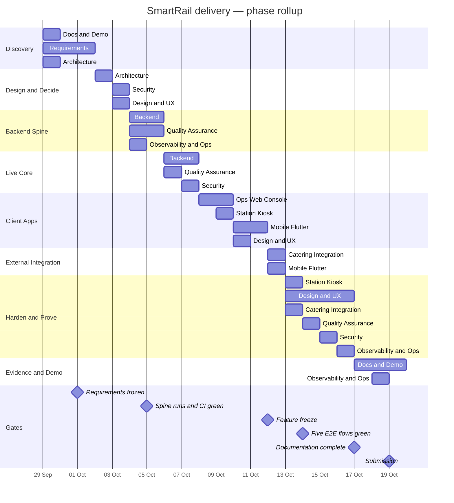

<!-- GENERATED by plan/plan.mjs — do not edit. Edit plan/tasks.yaml then: npm run build -->

# SmartRail — Gantt

Generated 2026-10-01 · D1 = 2026-09-29 · 21 days · owner Malindu Pabasara

## 1. Phase rollup

## 2. Task detail by workstream

```mermaid
gantt
    dateFormat YYYY-MM-DD
    axisFormat %d %b
    title SmartRail delivery — task detail

    section Requirements
    Decompose brief into atomic statements tagged GIVEN IMPLIED AB :D1-1, 2026-09-29, 1d
    Persona interviews 1 to 6 commuter traveller impaired driver s :D1-2, 2026-09-29, 1d
    Persona interviews 7 to 12 CS-agent catering security QA acces :D2-1, 2026-09-30, 1d
    Adversarial pass what would make each persona distrust the sys :D2-2, 2026-09-30, 1d
    Edge case catalogue target 40 plus entries :D2-3, 2026-09-30, 1d
    Assumptions register from plan section 6 findings :D2-4, 2026-09-30, 1d
    Reconcile persona conflicts and record losing options :D3-1, 2026-10-01, 1d
    Prioritise requirements MoSCoW plus risk times value :D3-2, 2026-10-01, 1d
    Write user stories and acceptance criteria for all Must items :D3-3, 2026-10-01, 1d
    Build traceability matrix skeleton REQ to US to AC to test :D3-4, 2026-10-01, 1d
    Send open questions OQ-01 to OQ-08 to assessors and freeze sco :crit, D3-5, 2026-10-01, 1d

    section Architecture
    Create repo skeleton and docs folder structure :D1-3, 2026-09-29, 1d
    Domain model stations routes services timetable versions calen :D4-1, 2026-10-02, 1d
    Journey state machine diagram including Unknown and Terminated :D4-2, 2026-10-02, 1d
    Write ADR 0001 to 0008 :D4-3, 2026-10-02, 1d
    C4 context and container diagrams :D4-4, 2026-10-02, 1d

    section Security
    STRIDE threat model per trust boundary :D5-1, 2026-10-03, 1d
    Permission matrix for ten roles with scoped permissions :D5-2, 2026-10-03, 1d
    Data classification and retention schedule :D5-3, 2026-10-03, 1d
    Append-only audit trail for high-consequence actions :D9-3, 2026-10-07, 1d
    Authorization negative test suite IDOR cross-station role esca :D17-1, 2026-10-15, 1d
    ZAP baseline scan and triage :D17-2, 2026-10-15, 1d
    Dependency and secret scanning gates in CI :D17-3, 2026-10-15, 1d
    Fix or formally accept every security finding in writing :D17-4, 2026-10-15, 1d

    section Design and UX
    Design tokens v1 colour status semantics three type scales :D5-4, 2026-10-03, 1d
    Wireframe the six demo-critical screens :D5-5, 2026-10-03, 1d
    Design token codegen tokens json to Dart and CSS :D12-2, 2026-10-10, 1d
    Empty loading stale error offline states across all nineteen s :D15-2, 2026-10-13, 1d
    i18n scaffolding and secondary language strings for passenger  :D15-4, 2026-10-13, 1d
    Accessibility pass axe keyboard screen reader contrast dynamic :D18-1, 2026-10-16, 1d
    Display legibility verification at five to ten metres :D18-2, 2026-10-16, 1d

    section Backend
    Scaffold dotnet solution with Domain Application Infrastructur :D6-1, 2026-10-04, 1d
    EF Core model and first migration :D6-2, 2026-10-04, 1d
    Seed network twelve stations six routes forty services :D6-3, 2026-10-04, 1d
    Identity JWT per-audience tokens and permission claims :D6-4, 2026-10-04, 1d
    Network and Timetable read endpoints stations departures route :D7-1, 2026-10-05, 1d
    Timetable admin writes with draft publish supersede versioning :D7-2, 2026-10-05, 1d
    OpenAPI document and generated typed clients :D7-3, 2026-10-05, 1d
    Journey generation from timetable plus service date handling :D8-1, 2026-10-06, 1d
    Telemetry ingestion with sequence idempotency and plausibility :D8-2, 2026-10-06, 1d
    ETA propagation engine offset plus dwell model with confidence :D8-3, 2026-10-06, 1d
    Redis journey progress projection :D8-4, 2026-10-06, 1d
    SignalR hub with snapshot then delta protocol and jittered rec :D9-1, 2026-10-07, 1d
    Disruptions module publish update retract with scope and reaso :D9-2, 2026-10-07, 1d
    Notification outbox dedup and throttle rules :D9-4, 2026-10-07, 1d

    section Ops Web Console
    Ops console shell auth routing and layout :D10-1, 2026-10-08, 1d
    Live Network Board with realtime deltas and filters :D10-2, 2026-10-08, 1d
    Timetable and Journeys screen with per-journey actions :D10-3, 2026-10-08, 1d
    Disruption Console with passenger preview and network-wide con :D11-1, 2026-10-09, 1d
    Station and Device Health screen with heartbeat and revoke :D11-2, 2026-10-09, 1d
    Punctuality report with export :D11-3, 2026-10-09, 1d

    section Mobile Flutter
    Flutter melos monorepo core design_system api_client packages :D12-1, 2026-10-10, 1d
    Passenger plan and station departures screens :D12-3, 2026-10-10, 1d
    Passenger journey detail with live progress and confidence chi :D12-4, 2026-10-10, 1d
    Follow a journey subscriptions preferences and quiet hours :D13-1, 2026-10-11, 1d
    Push notifications via FCM with dedup verification :D13-2, 2026-10-11, 1d
    Driver duty roster and sign-on :D13-3, 2026-10-11, 1d
    Driver active journey glanceable stop list :D13-4, 2026-10-11, 1d
    Driver stop confirm with Drift offline queue and replay :D13-5, 2026-10-11, 1d
    Passenger food ordering UI over external menu :crit, D14-5, 2026-10-12, 1d

    section Station Kiosk
    Kiosk display mode platform and concourse boards :D11-4, 2026-10-09, 1d
    Service worker last-known-good snapshot and staleness banner :D11-5, 2026-10-09, 1d
    Kiosk terminal mode search route explore station info and idle :D15-1, 2026-10-13, 1d

    section Catering Integration
    RailBite Node app menu stock station eligibility and order lif :D14-1, 2026-10-12, 1d
    SmartRail outbound reference and ETA feed with API key auth :D14-2, 2026-10-12, 1d
    Inbound HMAC signed webhooks with replay window and idempotenc :D14-3, 2026-10-12, 1d
    Outbox retry backoff circuit breaker and dead letter queue :D14-4, 2026-10-12, 1d
    Nightly order state reconciliation job :D15-3, 2026-10-13, 1d

    section Quality Assurance
    First domain unit tests on invariants and IClock abstraction :D6-5, 2026-10-04, 1d
    GitHub Actions pipeline build unit integration and architectur :crit, D7-4, 2026-10-05, 1d
    Journey simulator with six seeded scenarios :D8-5, 2026-10-06, 1d
    E2E flow one passenger follows a delayed train :D16-1, 2026-10-14, 1d
    E2E flow two driver confirms offline and reconciles :D16-2, 2026-10-14, 1d
    E2E flow three ops cancels a running journey and it propagates :D16-3, 2026-10-14, 1d
    E2E flow four food order across the external boundary :D16-4, 2026-10-14, 1d
    E2E flow five display survives connectivity loss honestly :D16-5, 2026-10-14, 1d
    Consumer driven contract tests both directions :crit, D16-6, 2026-10-14, 1d

    section Observability and Ops
    Docker compose api db redis seq and Flutter toolchain smoke te :D6-6, 2026-10-04, 1d
    OpenTelemetry dashboards network integration and device health :D18-3, 2026-10-16, 1d
    Runbook SLO document and alert definitions :D18-4, 2026-10-16, 1d
    Verify clean checkout to running system from README :D20-4, 2026-10-18, 1d

    section Docs and Demo
    Author master delivery plan and scope decisions :done, D1-0, 2026-09-29, 1d
    Start AI journal and commit-trailer convention :D1-4, 2026-09-29, 1d
    Finalise traceability matrix REQ to test coverage :D19-1, 2026-10-17, 1d
    Consolidate ADRs and architecture documentation :D19-2, 2026-10-17, 1d
    Write quality assessment including known weaknesses :D19-3, 2026-10-17, 1d
    Assemble AI usage pack journal prompt library and ai-was-wrong :D19-4, 2026-10-17, 1d
    Data and privacy document with classification and rights :crit, D19-5, 2026-10-17, 1d
    Build deterministic demo seed scenario and narrative script :D20-1, 2026-10-18, 1d
    Rehearse full demo twice end to end :D20-2, 2026-10-18, 1d
    Record fallback demo video :D20-3, 2026-10-18, 1d
    Buffer for slipped work :D21-1, 2026-10-19, 1d
    Final presentation deck and engineering story :D21-2, 2026-10-19, 1d
    Final review and submission :crit, D21-3, 2026-10-19, 1d
```

## 3. Day calendar

| Day | Date | Phase | Load | Tasks | Gate |
|---|---|---|---|---|---|
| D1 | Tue 09-29 | Discovery | 10h | 5 |  |
| D2 | Wed 09-30 | Discovery | 8h | 4 |  |
| D3 | Thu 10-01 | Discovery | 8h | 5 | **Requirements frozen** |
| D4 | Fri 10-02 | Design and Decide | 8h | 4 |  |
| D5 | Sat 10-03 | Design and Decide | 8h | 5 |  |
| D6 | Sun 10-04 | Backend Spine | 9h | 6 |  |
| D7 | Mon 10-05 | Backend Spine | 8h | 4 | **Spine runs and CI green** |
| D8 | Tue 10-06 | Live Core | 8h | 5 |  |
| D9 | Wed 10-07 | Live Core | 8h | 4 |  |
| D10 | Thu 10-08 | Client Apps | 8h | 3 |  |
| D11 | Fri 10-09 | Client Apps | 8h | 5 |  |
| D12 | Sat 10-10 | Client Apps | 8h | 4 |  |
| D13 | Sun 10-11 | Client Apps | 8h | 5 |  |
| D14 | Mon 10-12 | External Integration | 9.5h | 5 | **Feature freeze** |
| D15 | Tue 10-13 | Harden and Prove | 8h | 4 |  |
| D16 | Wed 10-14 | Harden and Prove | 8h | 6 | **Five E2E flows green** |
| D17 | Thu 10-15 | Harden and Prove | 8h | 4 |  |
| D18 | Fri 10-16 | Harden and Prove | 8h | 4 |  |
| D19 | Sat 10-17 | Evidence and Demo | 7.5h | 5 | **Documentation complete** |
| D20 | Sun 10-18 | Evidence and Demo | 7h | 4 |  |
| D21 | Mon 10-19 | Evidence and Demo | 6.5h | 3 | **Submission** |
